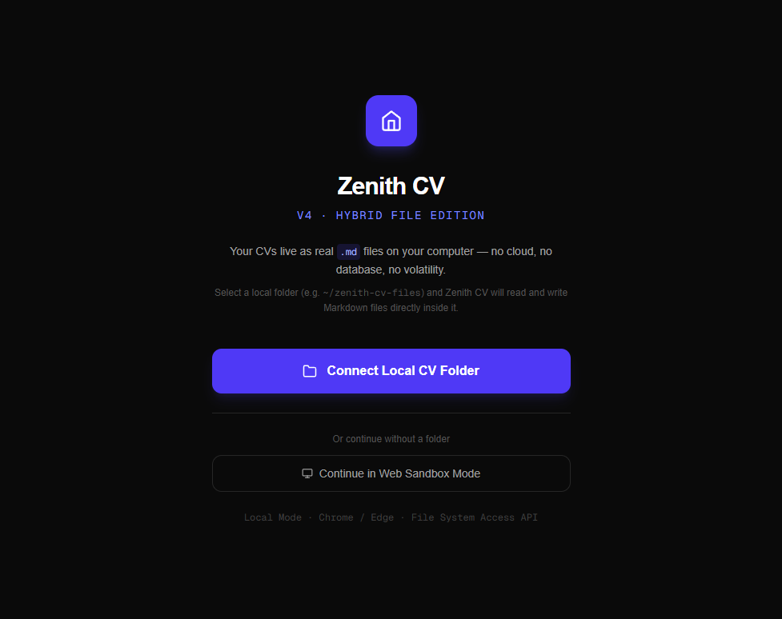
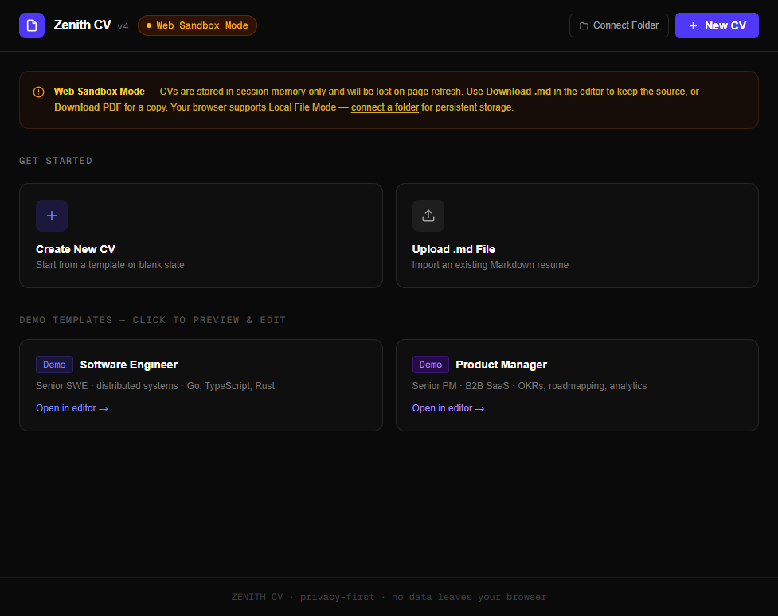
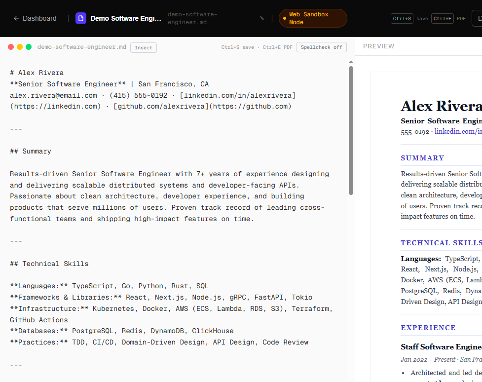
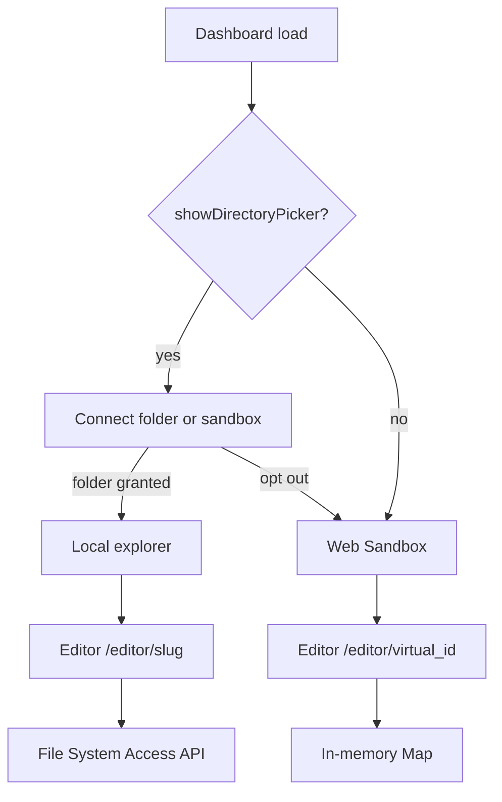

# Zenith CV

**Privacy-first, self-contained Markdown-to-PDF resume builder.**

[](https://github.com/LD-111/zenith-cv/actions/workflows/ci.yml)
[](LICENSE)
[](https://nextjs.org/)

[Live demo](https://cv.ldevia.dev/) · resumes stay in your browser. No accounts, no cloud, no lock-in.



Your CVs are plain `.md` files you control — on disk in Chrome/Edge, or in tab memory everywhere else. Live preview and a real text-based PDF, not a print-dialog screenshot.

## Why it exists

Typical resume tools trap data in a SaaS dashboard, emit PDF that ATS parsers struggle with, and add accounts for what should be text. Zenith CV treats the CV as first-class Markdown and renders a selectable, indexable PDF.

## Features

- **Hybrid storage** — Local File Mode (Chrome/Edge, File System Access API) writes `.md` files on disk. Web Sandbox Mode keeps virtual CVs in tab memory, with amber warnings, and is the path on Firefox, Safari, and the public demo.
- **Live editor + preview** — Split pane, GFM (tables, task lists, strikethrough). Preview matches the PDF.
- **Text-based PDF** — `@react-pdf/renderer` export (dynamically imported). Multi-page, ATS-friendly. A4 or US Letter, with a page-budget indicator.
- **Templates** — Engineering, Product Manager, and Blank. One-click demos. Upload an existing `.md`.
- **Autosave** — 500ms debounce, stream writes locally, flush on navigate. `Ctrl+S` saves, `Ctrl+E` exports PDF.
- **Rename, duplicate, download** — Inline rename on cards and in the editor. Duplicate opens a `-copy`. Download `.md` is the persist path in sandbox.
- **Themes** — Serif or compact Sans. One token set drives preview CSS and PDF.
- **Tailoring** — Insert experience, skills, education, or project blocks. Hidden `target` / `notes` frontmatter. Session-only job-description overlap check.
- **Remembered folder** — Chrome/Edge can reopen the last directory after refresh (handle only). Disconnect forgets it.





## Architecture

Runtime mode is feature-detected:

```ts
export function isFsSupported(): boolean {
  return typeof window !== "undefined" && "showDirectoryPicker" in window;
}
```



The editor is one route. If the id starts with `virtual_`, load and autosave go to the in-memory store; otherwise they go through the File System Access API.

| Mode    | Load                      | Autosave                         |
|---------|---------------------------|----------------------------------|
| local   | `readMdFile()` via FS API | `writeMdFile()` (stream write)   |
| virtual | `getVirtualCV(id)`        | `updateVirtualCV()` (Map mutate) |

Module-level state survives client navigation: `_dirHandle` in `fs-access.ts`, `Map<string, VirtualCV>` in `virtual-store.ts`. PDF generation walks mdast (`unified` + `remark-parse` + `remark-gfm`) and emits `@react-pdf/renderer` elements.

## Tech stack

| Layer     | Technology                                        |
|-----------|---------------------------------------------------|
| Framework | Next.js 16 (App Router)                           |
| Language  | TypeScript 5 (strict)                             |
| UI        | React 19                                          |
| Styling   | Tailwind CSS 4 (`@import "tailwindcss"`)          |
| Markdown  | `react-markdown` + `remark-gfm`                   |
| PDF       | `@react-pdf/renderer` + unified / remark          |
| Runtime   | Node 20+                                          |
| Lint      | ESLint 9 (flat config)                            |

## Getting started

```bash
cd zenith-cv
npm install
npm run dev
```

Open http://localhost:3000.

- Chrome/Edge: **Connect Local CV Folder** and pick (or create) a directory for `.md` files.
- Other browsers: **Continue in Web Sandbox Mode**, or use a demo template.
- Create, edit, rename, and **Download PDF**.

The Next.js app lives in the `zenith-cv/` folder. Run npm commands from there.

### Deploy

The live site is [https://cv.ldevia.dev/](https://cv.ldevia.dev/). To host your own copy on Vercel, set the **Root Directory** to `zenith-cv`. No environment variables are required.

## Privacy

- No accounts, cookies for content, analytics, or application backend.
- CV text is not copied into `localStorage` or IndexedDB.
- Chrome/Edge may store a **directory handle** in IndexedDB so the last folder can be reopened. Disconnect deletes that handle.
- Sandbox CVs live in tab memory and disappear on refresh.
- The tailor panel holds a pasted job description in memory only.

See [SECURITY.md](SECURITY.md) for how to report a vulnerability.

## Contributing

Issues and pull requests are welcome. The nested `AGENTS.md` files are architecture notes for AI-assisted development (storage, PDF, dashboard phases). They are not end-user docs; start with this README.

## License

[MIT](LICENSE) © 2026 Lorenzo Devia Rubio. Use it, modify it, ship it.

---

Built for people who want their resumes **versionable, private, and portable**.
